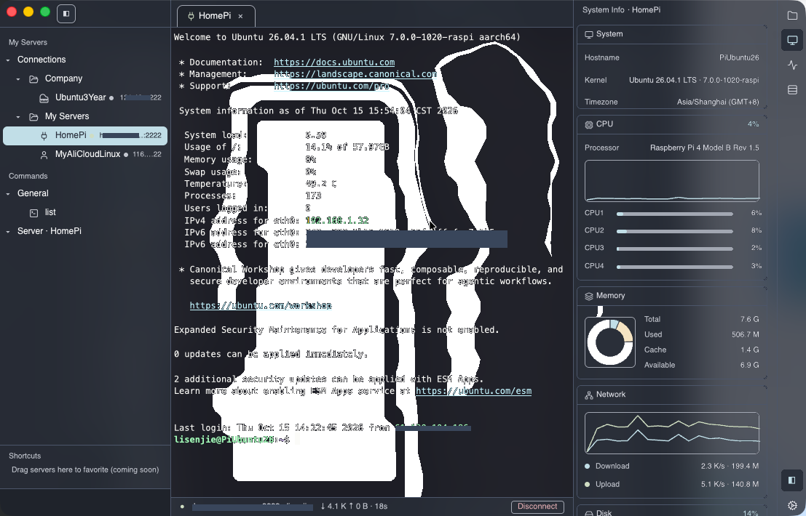
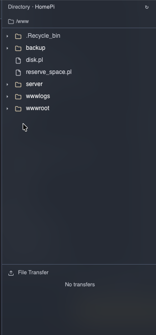
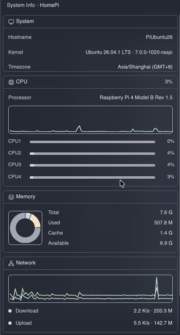
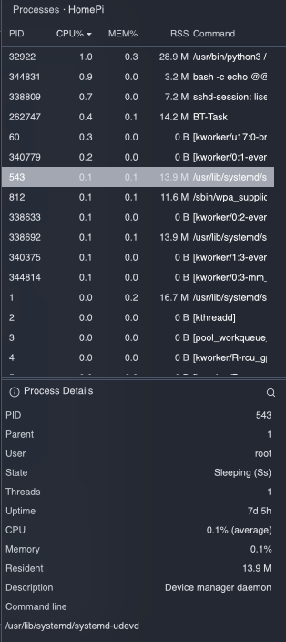

# sshrust

[English](README.md) | 简体中文

Rust + [GPUI](https://github.com/longbridge/gpui) 打造的 SSH 服务器管理软件（类 Termius / XShell）。

现有 SSH 客户端总让人二选一：Termius、XShell 这类成熟的 GUI 工具按订阅收费、或仅限个人使用授权；
免费替代品则多为 Electron 套壳，为了画一个终端拖上整套 Chromium 运行时——还没连上服务器就先吃掉
150–300 MB 内存。sshrust 走了另一条路：全原生 Rust 技术栈（协议层 russh + 界面层 GPUI），
单个约 24 MB 的可执行文件、闲置约 86 MB 内存，同时照样提供多标签终端、服务器分组管理、
远程文件浏览与 SFTP 传输、实时系统监控、远程进程面板与常用命令库——以及直连内网设备的
NAT 穿透 P2P 连接。

## 界面预览

### 主界面

macOS 全高侧栏 + 三栏布局：左侧「My Servers」服务器树（分组 / 状态指示点），中间多标签终端，
右侧可收缩工具面板；支持明暗主题与毛玻璃窗口。



### 远程目录

跟随终端 `cd` 自动同步（OSC 7 + `ls -la` 懒加载），图标化文件树，底部 SFTP
文件传输区（上传/下载带进度），分割线可拖并持久化。



### 系统信息

四张实时卡片：System（主机名 / 内核 / 时区 / 运行时间）、CPU（总占用 + 每核条 + 历史曲线）、
Memory（环形图 + 总量 / 已用 / 缓存 / 可用）、Network（上下行速率曲线 + 累计流量）。



### 进程面板

PID / CPU% / MEM% / RSS / 命令行列表，表头点击排序，点击行查看完整详情
（父进程 / 状态 / 线程数 / 运行时长等），内置规则库自动识别进程用途，并可跳转外部搜索。



## 体积与资源占用

macOS（Apple Silicon）release 构建实测：

| 指标 | 数值 |
| --- | --- |
| 可执行文件体积 | 约 24 MB，单文件自包含（含 P2P 协议栈），无捆绑运行时 |
| DMG 安装包 | 约 12 MB |
| 闲置内存 | 约 86 MB（活动监视器口径），长时间运行稳定 |

闲置内存中已包含 GPUI 拉起的 Metal GPU 驱动栈与字体 / 图标缓存，应用自身状态只占其中一小部分。
作为参照：Electron 空壳通常闲置 150–300 MB，同为 GPUI 技术栈的 Zed 闲置也在数百 MB 量级。

## 功能概览

- **会话管理**：服务器树（分组/拖拽/右键增删改/内联重命名）、密码或私钥认证
  （私钥内容直传 + 别名管理）；SQLite 持久化（`~/.sshrust/sshrust.db`，
  自动迁移旧 hosts.json）
- **终端**：多 tab 会话、tab 弹出/并回独立窗口、可收缩三栏、紧凑标题栏；
  连接过程实时分阶段日志（解析 → 握手 → 认证 → PTY），全程以别名标识
- **P2P 连接**：经 iroh 打通无公网设备的 SSH（relay 汇合 + QUIC 打洞，端到端加密）；
  链路指示（直连/中继/混合）+ 实测往返延迟 + 双方公网 IP 与运营商，中继卡死时
  自动重试打洞。relay/令牌在「设置 › 通用 › 网络」全局配置一次即可；目标机需运行
  [sshrust-agent](#p2p-与-sshrust-agent)
- **右侧工具面板**：远程目录（OSC 7 跟随 cd + `ls -la` 懒加载 + **SFTP 文件传输**：
  右键/按钮上传下载、进度/速度/取消、同名覆盖确认）、
  系统信息（CPU/内存/网络/磁盘实时图表）、会话状态、进程面板（CPU% 差分采样、
  排序、详情、进程作用识别 + 外部搜索）
- **常用命令**：通用命令库 + 每服务器专用命令，双击/右键直写 PTY 运行到控制台
- **外观**：明暗主题、窗口透明度 + 毛玻璃、macOS 全高侧栏（交通灯落侧栏）
- **多语言**：中英双语，即时切换
- **节点图标**：内嵌 Lucide SVG（317 个；42 分类图标选择器 + 按名称关键词自动匹配）

## P2P 与 sshrust-agent

连接没有公网地址的设备（家里的树莓派/NAS、校园网内网主机等），sshrust 配套
**sshrust-agent**——目标机上的轻量桥接程序：加入 iroh 网络（relay 汇合 + QUIC 打洞），
把入站流转发给本机 sshd。

- agent **闭源**，以预编译静态二进制分发（Linux `aarch64` / `x86_64`，零依赖），
  见 [Releases](https://github.com/samruoSoft/sshrust/releases) 页面。
- 目标机上安装：

  ```bash
  # 按架构下载对应二进制后：
  sudo mv sshrust-agent /usr/local/bin/sshrust-agent
  sudo env IROH_RELAY=https://你的relay IROH_RELAY_TOKEN=...        /usr/local/bin/sshrust-agent install   # 装 systemd 服务并开机自启
  sudo sshrust-agent id                       # 打印固定 NodeID
  ```

- app 内：「设置 › 通用 › 网络」配置一次 relay/令牌（留空使用 n0 免费公共设施），
  再以 **P2P** 方式新增服务器、粘贴 NodeID 即可连接。
- 安全性：流量在两端间端到端加密（身份即 NodeID 的密钥对）；relay 只见密文与元数据。

## 项目结构

- `core/`（sshrust-core）：russh 会话抽象 + iroh P2P 传输 + 进程内 mock 服务器
- `app/`（sshrust-app）：GPUI 桌面应用（见上）
- `ui-kit/`：gpui 组件库（base 简单组件 / pro 复合组件 + 主题注入，可跨项目复用，
  功能记录见 `ui-kit/FEATURES.md`）
- `spike/`：交互式 CLI 客户端（core 链路调试用）
- `third_party/gpui-terminal`：终端渲染 fork（补滚轮回滚 + 滚动 API）

> `sshrust-agent`（目标侧桥接程序）为闭源组件，不在本仓库内；
> 预编译二进制见 [Releases](https://github.com/samruoSoft/sshrust/releases) 页面。

## 快速开始

```bash
cargo run -p sshrust-app                # GUI
cargo run -p sshrust-app -- --mock-demo=2   # 自动开 2 个 mock 终端（演示）
cargo run -p spike -- --mock            # CLI 直连内置 mock（test/test）
cargo test --workspace                  # 全部测试
```

## 技术栈

russh 0.64 · russh-sftp 3.0 · iroh 1.3（P2P 传输） · gpui 0.2.2 · gpui-terminal 0.1.0（fork） · tokio · rusqlite（bundled）

> 注：依赖 gpui 0.2.2（crates.io 锁版）。

## 打包

```bash
cargo build --release -p sshrust-app    # 产物 target/release/sshrust-app
# .app bundle + DMG 见 scripts/package.sh
```
